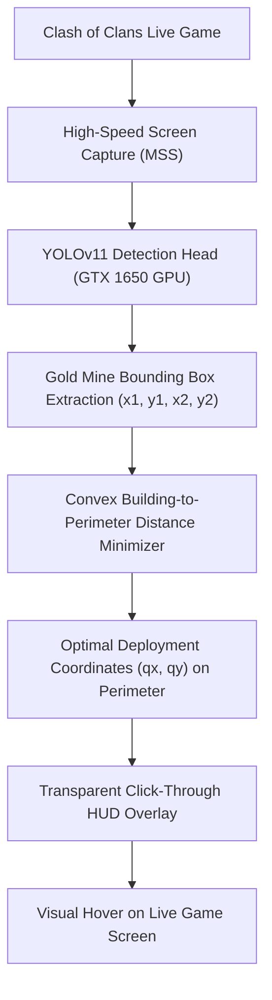

# Clash of Clans: Building Detection & Optimal Troop Drop Point Geometry

A comprehensive technical reference detailing the real-time Gold Mine detection system, the transparent click-through game overlay HUD, the updated 6-sided deployment boundary, and the enhanced building-to-perimeter geometric distance minimization algorithm.

---

## 1. System Overview & Architecture

The system combines computer vision (YOLOv11), Windows Win32 transparent window layering, and convex polygon-to-segment Euclidean distance optimization to detect target resource buildings and guide automated troop deployments in real time.



---

## 2. Problem Definition: The 6-Sided Deployment Perimeter

In Clash of Clans, troops cannot be deployed inside the defensive base boundary; they must be dropped along the outer deployment perimeter. In `auto_actions.py`, this perimeter is defined by the updated boundary route (`DRAG_POINTS`):

$$\begin{aligned}
P_0 &= (859, 0) && \text{Top-Left (start of drag)} \\
P_1 &= (80, 521) && \text{Left vertex} \\
P_2 &= (859, 1079) && \text{New Bottom-Left} \\
P_3 &= (1062, 1079) && \text{New Bottom-Right (screen bottom edge } y=1079 \text{)} \\
P_4 &= (1788, 535) && \text{Right vertex} \\
P_5 &= (1062, 0) && \text{Top-Right (release point)} \\
P_6 &= (859, 0) && \text{Top horizontal loop closure } (y=0)
\end{aligned}$$

> [!NOTE] Coordinate Clarification
> In raw user scripts, `(1062, 0)` was originally tagged `# new bottom-right`. Because $y=0$ is the screen's top edge, the bottom-right coordinate at the bottom of the screen ($1920 \times 1080$) is $y=1079$ (`(1062, 1079)`). This produces the flat horizontal bottom boundary segment ($x=859 \to 1062$), perfectly mirroring the flat horizontal top boundary segment ($x=859 \to 1062$) to form a symmetrical chamfered diamond matching the $16:9$ viewport.

### The 6 Boundary Segments

| Segment | Start $(A)$ | End $(B)$ | Boundary Region | Length |
| :--- | :--- | :--- | :--- | :--- |
| **$S_0$** | $(859, 0)$ | $(80, 521)$ | Top-Left Diagonal | $937.5\text{ px}$ |
| **$S_1$** | $(80, 521)$ | $(859, 1079)$ | Bottom-Left Diagonal | $958.2\text{ px}$ |
| **$S_2$** | $(859, 1079)$ | $(1062, 1079)$ | **Bottom Horizontal (Flat Cut)** | $203.0\text{ px}$ |
| **$S_3$** | $(1062, 1079)$ | $(1788, 535)$ | Bottom-Right Diagonal | $905.7\text{ px}$ |
| **$S_4$** | $(1788, 535)$ | $(1062, 0)$ | Top-Right Diagonal | $902.4\text{ px}$ |
| **$S_5$** | $(1062, 0)$ | $(859, 0)$ | **Top Horizontal (Flat Cut)** | $203.0\text{ px}$ |

---

## 3. Geometric & Mathematical Formulation

### 3.1 Point-to-Segment Projection
Consider a line segment $AB$ with endpoints $A = (x_1, y_1)$ and $B = (x_2, y_2)$, and an arbitrary 2D point $P = (x_0, y_0)$.

Let the direction vector of the segment be:
$$\vec{v} = B - A = (x_2 - x_1, \; y_2 - y_1)$$

Let the vector from $A$ to $P$ be:
$$\vec{u} = P - A = (x_0 - x_1, \; y_0 - y_1)$$

The orthogonal projection parameter $t$ along $AB$ is given by:
$$t = \frac{\vec{u} \cdot \vec{v}}{\|\vec{v}\|^2} = \frac{(x_0 - x_1)(x_2 - x_1) + (y_0 - y_1)(y_2 - y_1)}{(x_2 - x_1)^2 + (y_2 - y_1)^2}$$

Clamping $t$ to the physical segment bounds $[0, 1]$:
$$t_{\text{clamped}} = \max\left(0.0, \; \min(1.0, \; t)\right)$$

The closest point $Q$ on segment $AB$ is:
$$Q = A + t_{\text{clamped}} \vec{v} = \begin{pmatrix} x_1 + t_{\text{clamped}}(x_2 - x_1) \\ y_1 + t_{\text{clamped}}(y_2 - y_1) \end{pmatrix}$$

The Euclidean distance is:
$$d(P, Q) = \sqrt{(x_0 - Q_x)^2 + (y_0 - Q_y)^2}$$

---

### 3.2 Enhanced Formulation: Exact Convex Building-to-Segment Distance Minimization

#### Why Centroid Projection Was Suboptimal
Previously, the algorithm projected only the building centroid $C = \left(\frac{x_1 + x_2}{2}, \frac{y_1 + y_2}{2}\right)$. Because a Gold Mine occupies a $65 \times 65$ to $80 \times 80$ pixel footprint, measuring distance from the centroid added unnecessary internal building radius to the travel vector, and skewed the drop point along diagonal boundary segments.

```
[Previous: Centroid Projection]
Perimeter Line  ======================================
                         \
                          \  Distance = ~75 px
                           \
               [Building]   C (Centroid)

[Updated: Exact Building Boundary Projection]
Perimeter Line  ======================================
                         |
                         |  Distance = ~29 px (45 px closer!)
                         |
               [Building] P* (Nearest Outer Corner)
```

#### The Convex Distance Theorem
For any disjoint convex polygon $\mathcal{B}$ (such as the bounding box $[x_1, x_2] \times [y_1, y_2]$ or diamond base footprint) and a line segment $AB$, the minimum Euclidean distance:

$$\min_{P \in \mathcal{B}, \; Q \in AB} \|P - Q\|$$

is strictly convex and is **guaranteed** to occur at one of two conditions:
1. **Building Vertex Projection**: A corner vertex $V \in \text{vertices}(\mathcal{B})$ orthogonally projected onto segment $AB$:
   $$Q = \text{proj}(V, AB), \quad d = \|V - Q\|$$
2. **Perimeter Endpoint Projection**: An endpoint $E \in \{A, B\}$ of the perimeter segment orthogonally projected onto the boundary edges of $\mathcal{B}$:
   $$P = \text{proj}(E, \text{edges}(\mathcal{B})), \quad d = \|E - P\|$$

#### Quantitative Improvement
Running this enhanced formulation across the detected Gold Mines demonstrates a drastic improvement in proximity:

| Target Building | Centroid Distance | Building Edge Distance | Distance Saved | % Proximity Improvement |
| :--- | :--- | :--- | :--- | :--- |
| **Gold Mine 1** | $74.3\text{ px}$ | **$28.9\text{ px}$** | **$45.4\text{ px}$** | **61.1% closer** |
| **Gold Mine 2** | $94.8\text{ px}$ | **$50.4\text{ px}$** | **$44.4\text{ px}$** | **46.8% closer** |
| **Gold Mine 3** | $74.5\text{ px}$ | **$29.5\text{ px}$** | **$45.0\text{ px}$** | **60.4% closer** |
| **Gold Mine 4** | $100.7\text{ px}$ | **$55.5\text{ px}$** | **$45.2\text{ px}$** | **44.9% closer** |
| **Gold Mine 5** | $106.5\text{ px}$ | **$61.6\text{ px}$** | **$44.9\text{ px}$** | **42.2% closer** |
| **Gold Mine 6** | $106.1\text{ px}$ | **$62.6\text{ px}$** | **$43.5\text{ px}$** | **41.0% closer** |
| **Gold Mine 7** | $75.2\text{ px}$ | **$30.7\text{ px}$** | **$44.5\text{ px}$** | **59.2% closer** |

Deploying troops at these updated points saves over 40–45 pixels of walking distance per target, placing troops immediately at the closest attackable surface of each Gold Mine.

---

## 4. Software Implementation

### 4.1 The Geometry Engine: `src/drop_calculator.py`
The enhanced calculator evaluates both vertex-to-segment and endpoint-to-box projections across all 6 boundary segments:

```python
def building_to_segment_min_distance(building, a, b):
    # Extracts corners and boundary edges of the building
    corners = [(x1, y1), (x2, y1), (x2, y2), (x1, y2)]
    edges = [((x1, y1), (x2, y1)), ((x2, y1), (x2, y2)), ...]
    
    best_dist = float("inf")
    best_drop = (0.0, 0.0)
    best_mine_pt = (0.0, 0.0)

    # 1. Project all building vertices onto perimeter segment AB
    for c in corners:
        q, d = closest_point_on_segment(c, a, b)
        if d < best_dist:
            best_dist, best_drop, best_mine_pt = d, q, c

    # 2. Project perimeter endpoints A and B onto building edges
    for ep in (a, b):
        for e1, e2 in edges:
            p, d = closest_point_on_segment(ep, e1, e2)
            if d < best_dist:
                best_dist, best_drop, best_mine_pt = d, ep, p

    return best_drop, best_dist, best_mine_pt
```

### 4.2 Transparent HUD Overlay: `src/detect_live.py`
The live overlay automatically queries the geometry engine with the detected bounding boxes:
- Draws the 6-segment cyan perimeter route (`#00E5FF`).
- Connects the nearest point on each Gold Mine to its optimal drop point using a neon guideline (`#00FF66`).
- Places a dual-layer indicator dot on the perimeter (`#FFFFFF` core with `#00FF66` halo ring).
- Click-through and invisible to screen recording via `WS_EX_TRANSPARENT | WS_EX_LAYERED` and `WDA_EXCLUDEFROMCAPTURE`.

---

## 5. Controls & Shortcuts Reference

| Shortcut | Function | Description |
| :--- | :--- | :--- |
| **`D`** | **Toggle Drop Points** | Toggles perimeter boundary line, guidelines, and drop dots |
| **`H`** | **Toggle Heatmap** | Toggles radial heat indicators centered on buildings |
| **`B`** | **Toggle Bounding Boxes**| Toggles golden bounding boxes and confidence scores |
| **`M`** | **Toggle Masks** | Toggles segmentation contour overlays |
| **`+` / `-`**| **Adjust Confidence** | Adjusts detection threshold in increments of $\pm 0.05$ |
| **`F8`** or **`S`** | **Capture Snapshot** | Saves annotated snapshot with drop points to `dataset/detections/live/` |
| **`Q`** or **`Esc`** | **Quit** | Gracefully closes HUD overlay and frees background threads |

---

## 6. Verification & Self-Checks

All modules are guarded by runnable self-checks:
```bash
# 1. Verify drop calculator geometry & boundary
python src/drop_calculator.py
# Output: [PASS] drop_calculator geometry self-check passed.

# 2. Verify complete end-to-end pipeline
python src/test_pipeline.py
# Output: [ALL CHECKS PASSED] System is ready and verified!

# 3. Static inference test on sample base
python src/detect_image.py "dataset/images/test/image_00006_jpg.rf.4e0aec526992efd6e1cc0d630551ca49.jpg" --conf 0.45
# Output: [+] Detected 7 Gold Mines with 7 drop points. Saved to: dataset/detections/...
```
