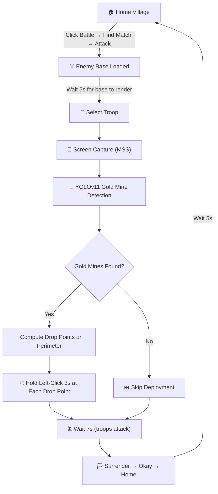
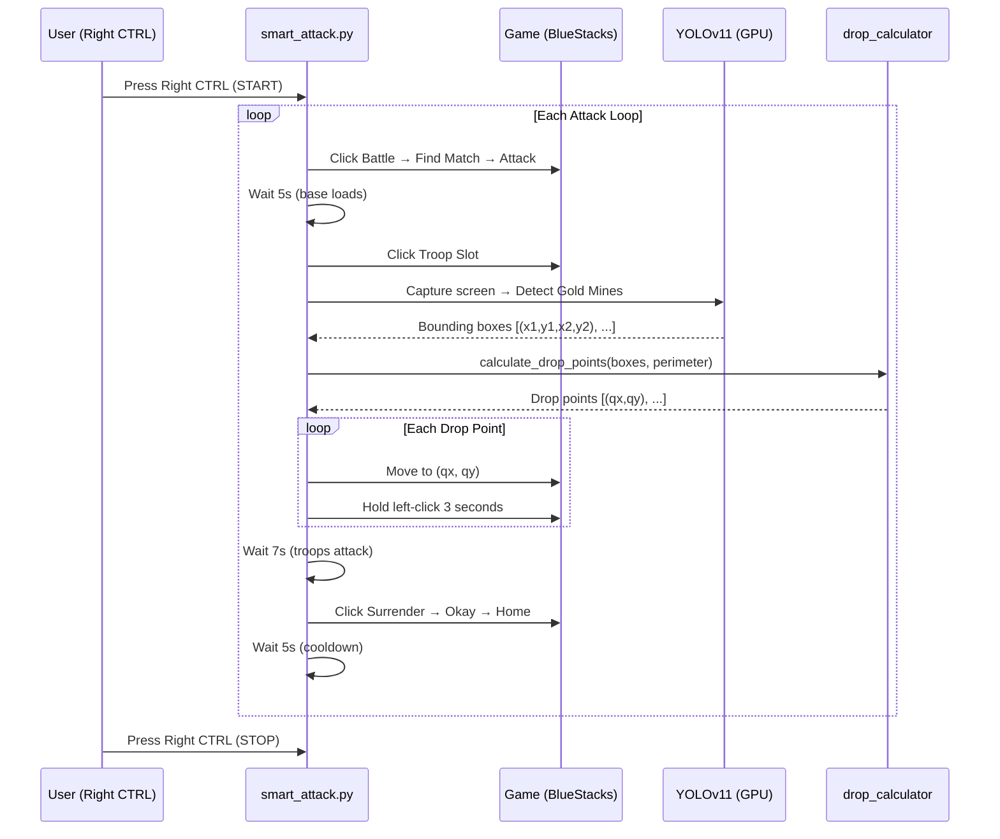

# Smart Attack: Vision-Guided Troop Deployment Automation

Automated Clash of Clans attack loop that uses real-time YOLO Gold Mine detection and geometric perimeter projection to deploy troops at mathematically optimal positions — no blind drag paths, every troop lands at the closest point to a real Gold Mine.

---

## 1. How It Works



Each loop iteration executes three phases:

| Phase | Actions | Duration |
|:------|:--------|:---------|
| **1. Navigate** | Battle → Find Match → Attack → Wait → Select Troop | ~8s |
| **2. Detect & Deploy** | Screenshot → YOLO → Drop Points → Hold-click each | ~3s per mine |
| **3. Exit** | Wait 7s → Surrender → Okay → Home → Wait 5s | ~14s |

---

## 2. The Detection & Deployment Pipeline

### 2.1 Screen Capture
Uses `mss` (Memory Screenshot) to grab the primary monitor at full 1920×1080 resolution. Runs on GPU via CUDA.

### 2.2 YOLO Gold Mine Detection
The trained `gold_mine_best.pt` model (YOLOv11n fine-tuned on 202 annotated Clash of Clans screenshots) detects Gold Mine bounding boxes `(x1, y1, x2, y2)` with confidence ≥ 0.45.

### 2.3 Perimeter Drop Point Calculation
For each detected Gold Mine bounding box, the `drop_calculator` engine finds the **exact closest point** on the 6-sided deployment perimeter using convex building-to-segment distance minimization (see [GEOMETRIC_DROP_POINT_SOLUTION.md](GEOMETRIC_DROP_POINT_SOLUTION.md)).

The 6-sided deployment perimeter:

```
         (859,0) ——————— (1062,0)         ← Top horizontal edge
        /                         \
       /                           \
(80,521)                       (1788,535)  ← Left & Right vertices
       \                           /
        \                         /
    (859,1079) ——— (1062,1079)            ← Bottom horizontal edge
```

### 2.4 Deduplication
Drop points within 15px of each other are merged to prevent stacking troops on the same spot when multiple Gold Mines project to nearby perimeter locations.

### 2.5 Troop Deployment
At each unique drop point `(qx, qy)`:
1. Move cursor to `(qx, qy)`
2. Press and **hold** left mouse button for **3 seconds**
3. Release

Holding for 3 seconds deploys a stream of the selected troop type at that exact location.

---

## 3. File Structure

```
src/
├── smart_attack.py       ← This automation script
├── drop_calculator.py    ← Geometry engine (perimeter projection)
├── detect_live.py        ← Transparent HUD overlay (visual aid)
├── detect_image.py       ← Static image inference tool
├── heatmap.py            ← Heatmap blending utility
└── train.py              ← YOLO training pipeline
```

### Key Dependencies

| Module | Purpose |
|:-------|:--------|
| `drop_calculator.DEFAULT_PERIMETER` | The 6 boundary vertices |
| `drop_calculator.calculate_drop_points()` | Box-to-perimeter projection |
| `ultralytics.YOLO` | Gold Mine detection model |
| `mss` | High-speed screen capture |
| `pyautogui` | Mouse movement, click, hold |
| `pynput` | Global hotkey listener |

---

## 4. Usage

```powershell
# From the project root
python src/smart_attack.py
```

### Controls

| Key | Action |
|:----|:-------|
| **Right CTRL** | Toggle start / stop |
| **ESC** | Quit the script |
| **Mouse Corner** | Emergency stop (pyautogui failsafe) |

### Console Output Example

```
Loading model: models/gold_mine_best.pt
Model loaded. Classes: {0: 'gold_mine'}
Perimeter: 6 segments
Hold time per drop point: 3.0s

Ready. Right CTRL = start/stop, ESC = quit.
>>> STARTED

==================================================
--- Loop 1 ---
==================================================
  battle
  find a match
  attack
  wait
  troop
  [DETECT] Scanning for Gold Mines...
  [DETECT] Found 5 drop point(s)
  [DEPLOY 1/5] Hold at (334, 351) for 3.0s
  [DEPLOY 2/5] Hold at (492, 246) for 3.0s
  [DEPLOY 3/5] Hold at (616, 163) for 3.0s
  [DEPLOY 4/5] Hold at (1406, 259) for 3.0s
  [DEPLOY 5/5] Hold at (1488, 320) for 3.0s
  wait
  surrender
  okay
  home
  [LOOP] Waiting 5.0s before next attack...
```

---

## 5. Configuration

All tunable constants are at the top of [`src/smart_attack.py`](src/smart_attack.py):

```python
HOLD_SECONDS   = 3.0    # Seconds to hold left-click at each drop point
CONF_THRESHOLD = 0.45   # YOLO detection confidence threshold
IMGSZ          = 960    # Inference resolution (pixels)
LOOP_DELAY     = 5.0    # Pause between attack loops (seconds)
STEP_DELAY     = 0.3    # Pause between UI clicks (seconds)
MOVE_DURATION  = 0.1    # Cursor glide time (seconds)
MODEL_PATH     = "models/gold_mine_best.pt"
```

---

## 6. Comparison: Blind Drag vs Smart Attack

| Aspect | `auto_actions.py` (Blind Drag) | `smart_attack.py` (Vision-Guided) |
|:-------|:-------------------------------|:----------------------------------|
| **Troop Placement** | Drag along entire perimeter | Hold at specific Gold Mine drop points |
| **Target Awareness** | None — spreads troops everywhere | Detects Gold Mines via YOLO |
| **Efficiency** | Troops wasted on empty perimeter sections | Every troop walks toward a real Gold Mine |
| **Adaptability** | Fixed drag path for all bases | Adapts to each base's Gold Mine layout |
| **Detection** | None | YOLOv11n on GPU (~15 FPS on GTX 1650) |
| **Deployment Method** | Continuous drag sweep | 3-second hold at each optimal point |

---

## 7. Sequence Diagram



